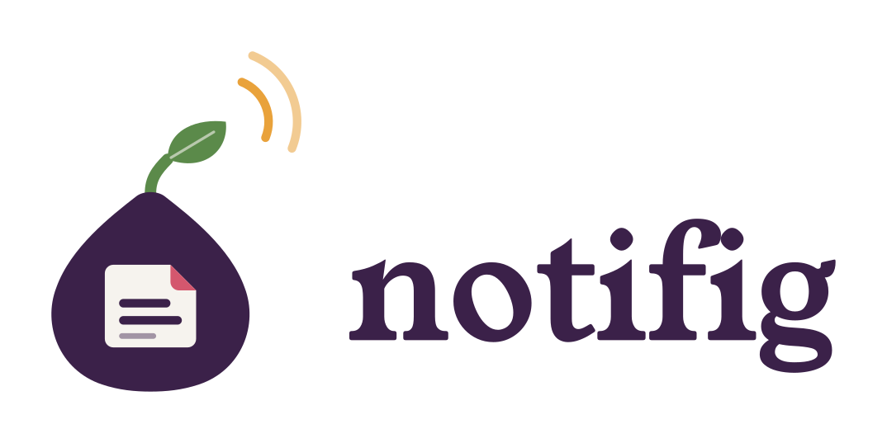

<picture>
  <source media="(prefers-color-scheme: dark)" srcset="docs/logo-dark.svg">
  
</picture>

**Notifig is a highly declarative, reactive, strictly typed library for project configurations**,
strongly rooted on these principles:

<details>
<summary><b>Declaration is behavior</b> - The shape of a config field derives its usage.</summary>

Validation, serialization, value choices, CLI flags, all follow from writing the field itself.
For example, this statement creates a `colors` field that only accepts certain values and can be
set both with comma-separated values (`--color "blue,red""`) or explicit lists: 

```python
from enum import Enum
from typing import Annotated
from pydantic import Field
from notifig import Choice, Delimited, CLIFlags


class Color(Enum)
    RED = "#FF0000"
    GREEN = "#00FF00"
    BLUE = "#0000FF"

COLORS = {name.lower(): color for name, color in Color.__members__.items()}

# Color type with restricted values
ColorType = Annotated[Color, Choice(COLORS)]
# List that can parse/serialize delimited color names (comma by default)
ColorList = Annotated[list[ColorType], Delimited()]
# List of colors with CLI flags
colors: Annotated[
    ColorList,
    CLIFlags(["color", "c"]),  # creates --color/-c CLI flags
] = Field(
    default="green",  # default value
    # info string for --help and CLI errors
    description="Available colors",
)

# Usage
#   YAML: `colors: green,blue`
#   CLI:  `--colors "blue,red"`
```
</details>


<details>
<summary><b>Single source of truth</b> - Settings should be declared once, in a single mutable single register.</summary>

A common example is mapping CLI flags to their config value, which usually involves maintaining a parallel
dict that references fields by string name and needs to be manually kept in sync with the config itself:

```python
class BadSettings:
    foo: str
    bar: str | None = None
    baz: int  # We added baz, but forgot to add its CLI flag below

# If any field gets renamed or deleted, someone has to remember to change it here.
CLI_FLAGS = {
    "foo": "foo",
    "f": "foo",
    "bar": "bar"
}

# Requires merging the CLI data into config fields 
for flag, value in cli_data.items():
    if (field := CLI_FLAGS[flag]):
        setattr(config, field, value)
```

With Notifig, the CLI flags live on their respective field declarations.
Deleting or altering a field and all its flags only touches one statement, in a single place.

```python
class Settings(Config):
    foo: Annotated[str, CLIFlags("foo", "f")] = Field(description="Value of Foo")
    bar: Annotated[str|None, CLIFlags("bar")] = Field(
        description="Name of Bar, if any",
        default=None,
    )
    baz: int = Field(description="Amount of Baz")
```
</details>


<details>
<summary><b>Distributed awareness</b> - Each part of an application only interacts with its own config section.</summary>

An application's structure hierarchy should map to its config structure.
Each component declares its own config section with the fields it needs, and does not need to be 
</details>


<details>
<summary><b>Reactive state</b> - Changes in the config should inform anyone interested.</summary>

Adding, changing or deleting an entry should able to trigger behavior instead of relying on periodic checks.
An observer is a callable or coroutine registered to a path, and it's called whenever it is altered.
A simple example where changing a UI's theme causes it to redraw:

```python
from typing import Annotated
from pydantic import Field
from notifig import Config, ConfigSection, ConfigChange, Choice

class UIConfig(ConfigSection):
    theme: Annotated[str, Choice(["dark", "light"])] = Field(default="light")

class Settings(Config):
    ui: UIConfig = Field(default_factory=UIConfig)

config = Settings()

# sync observer that logs every change
@config.on_change()
def print_changes(section: ConfigSection, changes: tuple[ConfigChange]):
    for change in changes:
        print(f"Change of type {change.__class__.__name__} on {change.path}")

# Simple assignment works for sync observers
config.ui.theme = "dark"
config.ui.theme = "light"
        
# async observer that redraws UI theme
@config.on_change("ui.theme")
async def redraw_theme(section: ConfigSection, changes: tuple[ConfigChange]):
    await interface.update_theme(section.ui.theme)

# Async observers require `await` to be called
await config.ui.set_and_wait(theme="dark")
```
</details>


## Install

```bash
pip install notifig
```

Requires Python ≥ 3.13.


## Features

- **Atomic batches** - Change multiple fields at once, retaining the original state upon failure.
- [**Observers**](./docs/about.md#observers) - register callables to react to config changes
(supports asyncio).
- [**Custom annotations**](./docs/annotations.md#annotations) - Notifig introduces several
custom Pydantic annotations to express behavior from types:
  - [CLIFlags](./docs/annotations.md#cli-flags) - add shortcut CLI flags for a field
  - [Choice](./docs/annotations.md#choice) - restricts options for a field, mapping names to values
  - [Delimited](./docs/annotations.md#delimited) - parses and serializes a string like `"a|b|c"` into a typed list
  - [Link](./docs/annotations.md#link) - one field mirrors another by path reference
  - [Paths](./docs/annotations.md#paths) - annotations for filesystem paths, absolute paths and glob patterns
- **Dynamic entries** - `DynamicSection` can add, remove and re-type new entries at runtime
- **File formats** - supports a wide range of file formats, including JSON, YAML, TOML, INI and .env


### Built on

- [Pydantic](https://pydantic.dev/) - Type foundation
- [Pydantic Settings](https://pydantic.dev/docs/validation/latest/concepts/pydantic_settings/) -
Loading data from CLI+files+env into a validated model
- [anyconfig](https://github.com/ssato/python-anyconfig) - File loading and serialization with wide format support.
