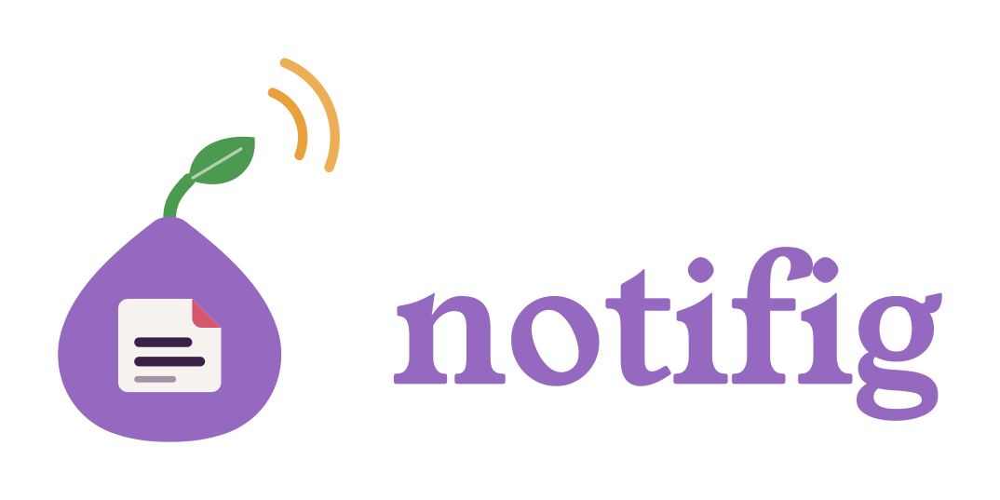

<picture>
  
</picture>

Notifig is a highly declarative, reactive, strictly typed library for project configurations.

It merges data from config files, CLI and env into a structured Pydantic `Config`. 


## Principles

- [**Declaration is behavior**](./docs/principles.md#declaration-is-behavior) -
The shape of a config field derives its usage.

- [**Single source of truth**](./docs/principles.md#single-source-of-truth) -
Settings should be declared once, in a single mutable register

- [**Scoped ownership**](./docs/principles.md#scoped-ownership) - 
Each project part declares and interacts with its own config section.

- [**Reactive state**](./docs/principles.md#reactive-state) -
Changes in the config should immediately inform registered observers.


## Install

```bash
pip install notifig
```

Requires Python ≥ 3.13.


## Features

- [**Atomic batches**](./docs/features.md#atomic-writing) - change multiple fields at once, retaining the original state upon failure.
- **Auto-saving** - configs can be saved manually to a file or be set to automatically save upon changes.
- [**Observers**](./docs/features.md#observers) - register callables to react to config changes
(supports asyncio).
- [**Custom annotations**](./docs/annotations.md#annotations) - Notifig introduces several
custom Pydantic annotations to express behavior from types:
  - [CLIFlags](./docs/annotations.md#cli-flags) - add shortcut CLI flags for a field.
  - [Choice](./docs/annotations.md#choice) - restricts options for a field, mapping names to values.
  - [Delimited](./docs/annotations.md#delimited) - parses and serializes a string like `"a|b|c"` into a typed list.
  - [Link](./docs/annotations.md#link) - one field mirrors another by path reference.
  - [Paths](./docs/annotations.md#paths) - annotations for filesystem paths, absolute paths and glob patterns.
- [**Dynamic entries**](./docs/features.md#sections) - `DynamicSection` can add, remove and re-type new entries at runtime.
- **File formats** - supports loading and saving from a wide range of file formats: JSON, YAML, TOML, INI and .env .


### Built on

- [Pydantic](https://pydantic.dev/) - Type foundation.
- [Pydantic Settings](https://pydantic.dev/docs/validation/latest/concepts/pydantic_settings/) -
Loading data from CLI+files+env into a validated model.
- [anyconfig](https://github.com/ssato/python-anyconfig) - File loading and serialization with wide format support.
